# PDFNova

**Online PDF tools that run on ordinary shared hosting.** Merge, split, compress, rotate, organize, watermark, protect and convert PDFs — built with plain PHP 8 and MySQL, so it deploys to hosts like Hostinger with no Node server, Docker or VPS.

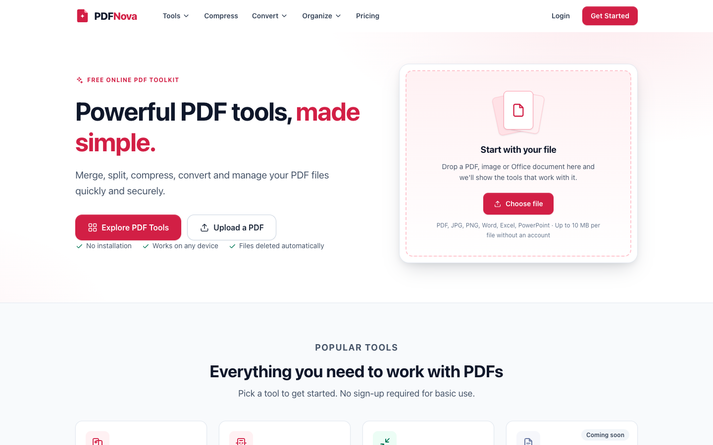

---

## Features

### PDF tools

| Tool | How it runs | Status |
|---|---|---|
| Merge PDF | Server (PHP) | ✅ Works |
| Split PDF (ranges, every page, ZIP download) | Server | ✅ Works |
| Organize PDF (reorder / delete pages) | Server | ✅ Works |
| Rotate PDF (lossless, via `/Rotate`) | Server | ✅ Works |
| Compress PDF (image re-encoding + stream deflate) | Server | ✅ Works |
| Watermark PDF (text or image, position, rotation, opacity, pages) | Server | ✅ Works |
| Protect PDF (AES-256 password) | Server | ✅ Works |
| Unlock PDF (with the correct password) | Server | ✅ Works |
| JPG / PNG to PDF | Server | ✅ Works |
| PDF to JPG | In the browser (pdf.js) — never uploaded | ✅ Works |
| Word / Excel / PowerPoint ⇄ PDF | External API (CloudConvert adapter) | ⚙️ Needs an API key |
| OCR PDF | External API (OCR.space adapter) | ⚙️ Needs an API key |

Tools that need an API key are clearly marked **"not available yet"** until one is configured — there are no fake buttons and no pretend conversions.

### Platform

- **Accounts** — registration, login, password reset by email, "sign out other devices", account deletion.
- **Dashboard** — file history, usage against plan limits, re-download of recent results.
- **Plans** — Free / Pro / Business limits (file size, files per task, daily tasks, history). Online payment is not implemented yet; plans are assigned by an admin.
- **Admin panel** — users, files, processing jobs, contact messages, subscriptions, site settings, audit log, and a live **System check** of the server setup.
- **Automatic cleanup** — uploads are deleted as soon as processing succeeds, results after 2 hours, old records on a schedule (cron job).
- **SEO** — per-page titles and descriptions, canonical URLs, Open Graph images, JSON-LD, dynamic `robots.txt` and `sitemap.xml`.
- **Legal pages** — Privacy Policy, Terms, Cookie Notice and Security page generated from the real configuration.

## Screenshots

| Merge PDF | Result |
|---|---|
| 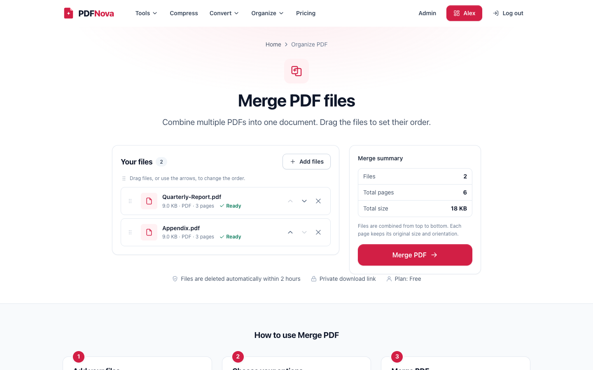 | 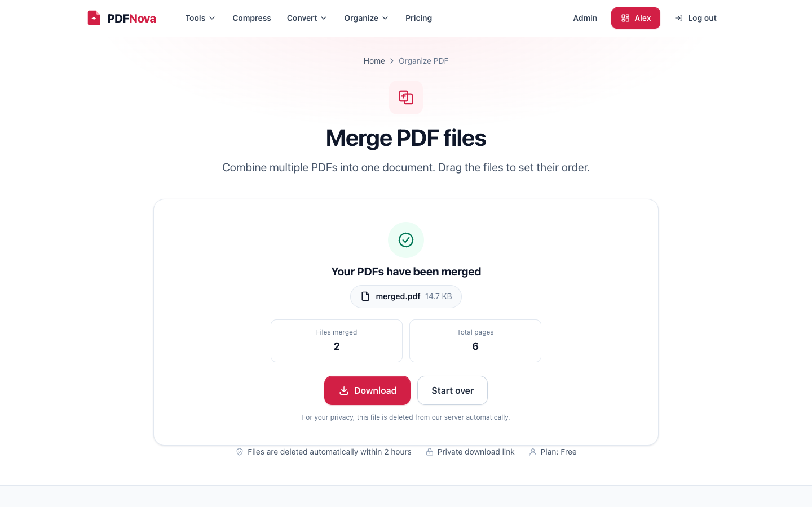 |

| Compress PDF | Pricing |
|---|---|
| 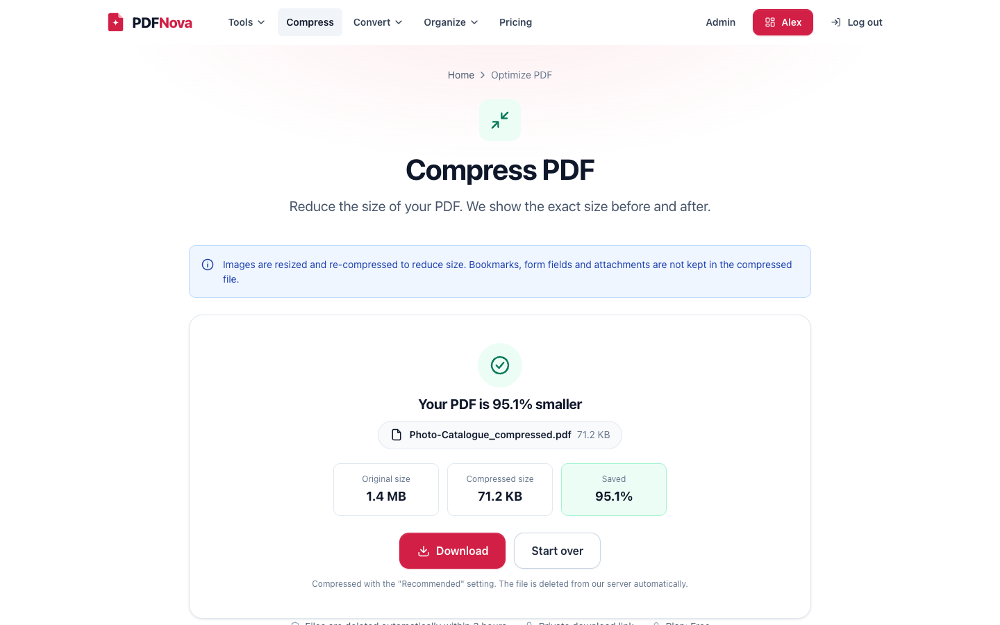 | 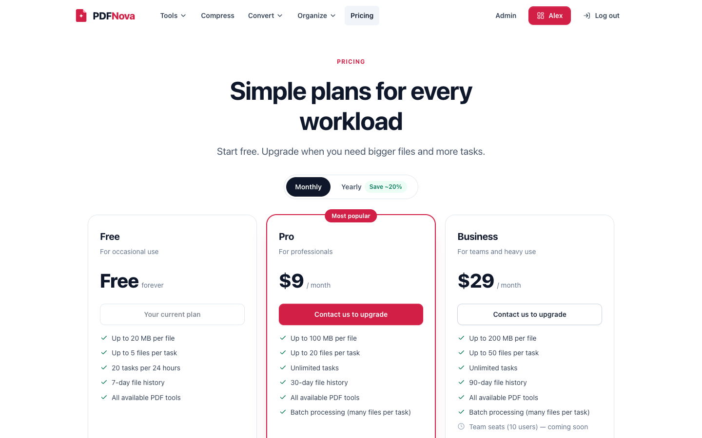 |

| User dashboard | Admin dashboard |
|---|---|
| 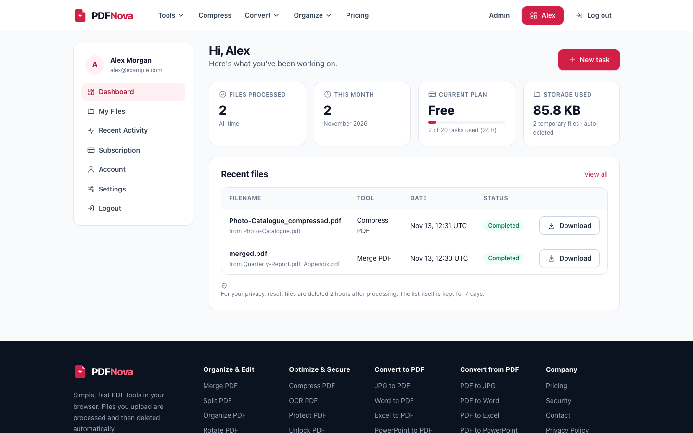 | 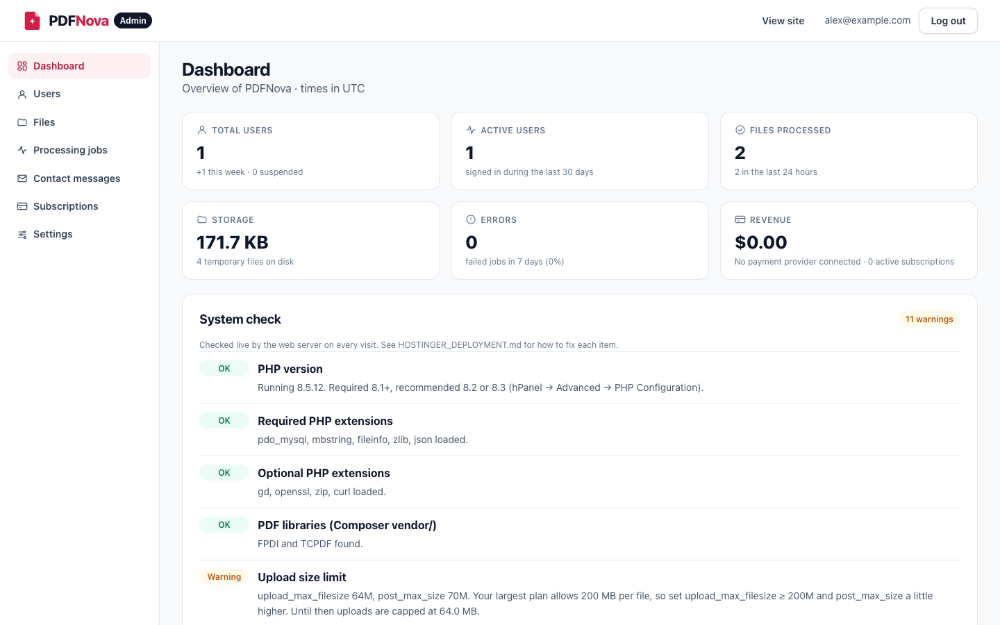 |

| All tools | Admin System check |
|---|---|
| 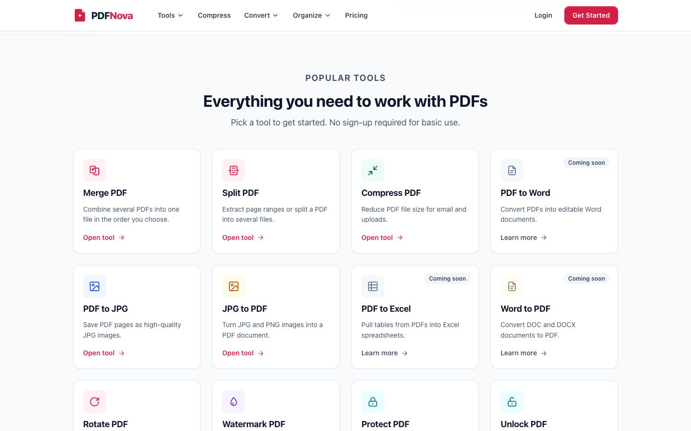 | 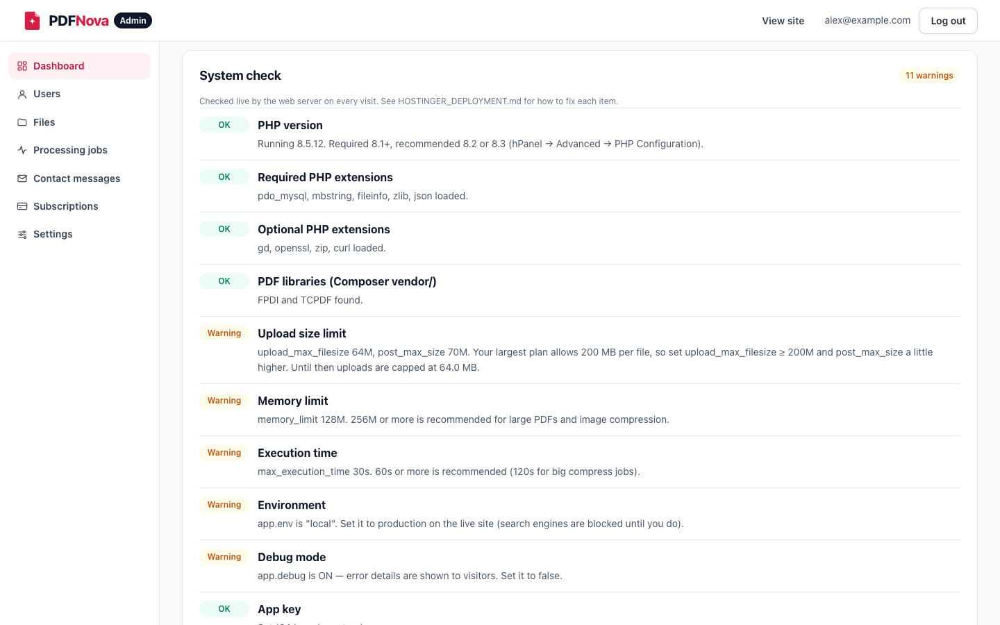 |

| Mobile | Mobile tool page |
|---|---|
| 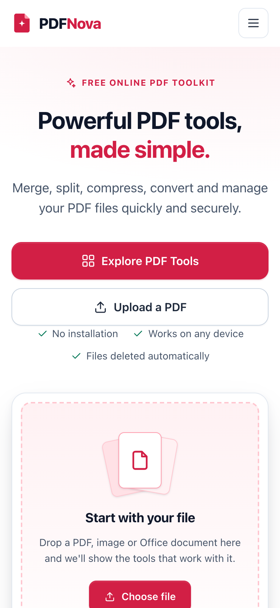 | 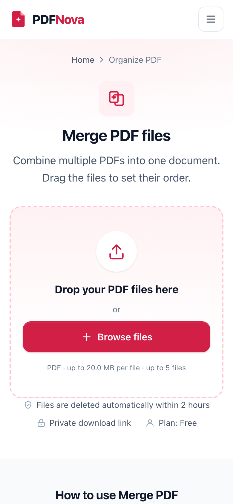 |

---

## Tech stack

- **Backend:** PHP 8.1+ (no framework), MySQL / MariaDB via PDO with prepared statements only
- **PDF engine:** [FPDI](https://github.com/Setasign/FPDI) + [TCPDF](https://github.com/tecnickcom/TCPDF), extended with our own parser for PDF 1.5+ cross-reference streams, object streams and encrypted files (RC4, AES-128, AES-256)
- **Frontend:** vanilla JavaScript (ES modules), hand-written CSS, [pdf.js](https://mozilla.github.io/pdf.js/) for previews and PDF→JPG
- **Server:** Apache / LiteSpeed with `.htaccess` (front controller, security headers, blocked private folders)
- **Optional:** Ghostscript for stronger compression, CloudConvert for Office conversion, OCR.space for OCR — all behind adapters

## Requirements

- PHP **8.1+** with `pdo_mysql`, `mbstring`, `fileinfo`, `zlib`, `json` (plus `gd`, `openssl`, `zip`, `curl` for the full feature set)
- MySQL 5.7+ / MariaDB 10.4+
- Apache or LiteSpeed with `mod_rewrite` and `.htaccess` enabled
- Composer (on your computer, to build `vendor/`)

## Quick start (local)

```bash
git clone https://github.com/Sameer348/pdfNova.git
cd pdfNova
composer install
cp public_html/includes/config.example.php public_html/includes/config.php
```

1. Create a database and import `public_html/database/schema.sql`.
2. Edit `public_html/includes/config.php`: database settings, `app.url` (e.g. `http://localhost:8080`), `app.env` = `local`, and a 64-character `app.key`:
   ```bash
   php -r "echo bin2hex(random_bytes(32)), PHP_EOL;"
   ```
3. Start the PHP dev server (the router mimics the `.htaccess` rules):
   ```bash
   php -S localhost:8080 -t public_html build/dev-router.php
   ```
4. Open http://localhost:8080, register an account, then make it an admin:
   ```sql
   UPDATE users SET role = 'admin' WHERE email = 'you@example.com';
   ```

There is **no default admin account** on purpose.

## Deploying to shared hosting

Build the upload package (installs `vendor/` without dev packages, excludes your `config.php` and runtime files, and checks every PHP file):

```bash
bash build/package.sh
```

Then follow **[HOSTINGER_DEPLOYMENT.md](HOSTINGER_DEPLOYMENT.md)** — database, upload, `config.php`, PHP settings, SSL, email, cron job, and a full test checklist. After deploying, the admin **System check** confirms the live setup.

## Project structure

```
pdfnova/
├── public_html/              ← everything that goes to the web root
│   ├── index.php             front controller (all page routes)
│   ├── .htaccess             rewrites, security headers, blocked folders
│   ├── admin/                admin panel
│   ├── api/                  JSON endpoints (upload, merge, split, compress, …)
│   ├── assets/               CSS, JS (ES modules), images, vendored pdf.js
│   ├── cron/                 cleanup.php (CLI only)
│   ├── database/             schema.sql + migrations
│   ├── includes/             bootstrap, config, auth, security, jobs, tools registry, …
│   ├── pages/                page templates (tools, auth, account, legal)
│   ├── services/             PDF engine, converters, OCR and payment adapters
│   ├── storage/              uploads / results / temp / logs (not web-accessible)
│   └── templates/            shared partials and tool option panels
├── build/                    package.sh, dev-router.php
├── docs/                     architecture, converters/OCR, payments, screenshots
└── HOSTINGER_DEPLOYMENT.md   step-by-step deployment guide
```

More detail: [docs/ARCHITECTURE.md](docs/ARCHITECTURE.md) · [docs/CONVERTERS_AND_OCR.md](docs/CONVERTERS_AND_OCR.md) · [docs/PAYMENTS.md](docs/PAYMENTS.md)

## Security

- CSRF tokens on every form and API call; strict Content Security Policy (no inline scripts or styles)
- Output escaping everywhere; prepared statements only
- Passwords hashed with Argon2id (bcrypt fallback); session renewal on login, idle and absolute timeouts, per-device sessions
- Rate limits on login, registration, password reset, contact form and uploads
- Uploads checked by real content (magic bytes / MIME), not by name or extension; stored under random names outside the web root's reach, with script execution disabled
- Signed, expiring, owner-bound download links
- Account-enumeration-safe login and reset flows

Files are **not** encrypted at rest; they are protected by access controls and short retention instead. See the in-app Security page for the full, honest description.

## Configuration notes

- **Never commit `public_html/includes/config.php`** — it holds your database password and app key. It is listed in `.gitignore`; use `config.example.php` as the template.
- `app.env` must be `production` on the live site (otherwise `robots.txt` blocks all crawlers on purpose).
- Fill in `legal.company`, `legal.address` and `legal.country` before going live, and have the legal pages reviewed for your country.

## License

Proprietary — all rights reserved. Third-party libraries (FPDI, TCPDF, pdf.js) are used under their own licenses.
